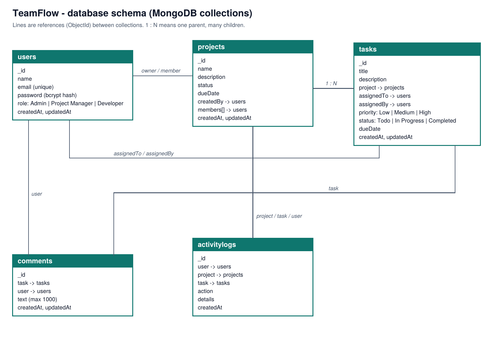
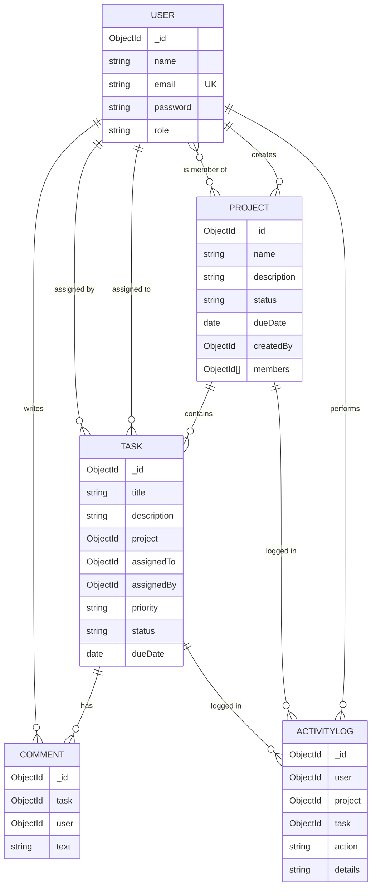

# TeamFlow

A full-stack team project and task management app. Managers create projects and assign tasks, developers update progress and discuss work in comments, and everyone sees changes live without refreshing the page.

| | |
|---|---|
| **Live app** | `<add your Vercel URL>` |
| **Live API** | `<add your Render URL>/api/health` |
| **Demo video** | `<add your video link>` |
| **API docs** | [Postman collection](postman/TeamFlow.postman_collection.json) |
| **Database schema** | [ER diagram](docs/er-diagram.png) |

> The free Render plan sleeps when idle, so the first request after a break can take about 30 seconds.

## Demo accounts

Replace these with the accounts you created.

| Role | Email | Password |
|---|---|---|
| Admin | `<email>` | `<password>` |
| Project Manager | `<email>` | `<password>` |
| Developer | `<email>` | `<password>` |

## Features

**Authentication and roles**
- Register, login and logout with JWT, bcrypt password hashing and protected routes.
- Three roles: Admin, Project Manager and Developer, enforced on the server.
- New registrations are always Developers, so nobody can make themselves an admin from the browser.

**Dashboard**
- Total projects and tasks, pending, completed and overdue counts.
- Completion percentage with a status bar, tasks that need attention first, project progress and recent activity.

**Projects and tasks**
- Create, view and delete projects, with progress calculated from their tasks.
- Create tasks with project, assignee, priority, due date and description.
- Change status (To do, In progress, Completed), filter and search tasks.
- Comments on every task and an activity log of status changes.

**Real time (Socket.io)**
- Authenticated sockets, a room per project and a personal room per user.
- New tasks, status changes and comments appear instantly for everyone who should see them.
- The assignee gets an on-screen notification the moment a task is assigned.

**Interface**
- Responsive layout: sidebar on desktop, bottom tabs on mobile.
- Loading skeletons, error messages with retry, empty states and form validation.

## Who can do what

| | Admin | Project Manager | Developer |
|---|---|---|---|
| See projects | All | Own or member | Member, or has an assigned task |
| See tasks | All | Tasks in their projects | Only tasks assigned to them |
| Create project / task | Yes | Yes | No |
| Change task status | Any task | Tasks in their projects | Own tasks |
| Comment | If they can access the task | If they can access the task | If they can access the task |
| View activity log | Yes | Yes | No |

### Giving someone the Admin or Project Manager role

Anyone can register, but only as a Developer. To promote a user, open the `users` collection in MongoDB Atlas (or Compass), change that user's `role` to `Admin` or `Project Manager`, then sign out and sign in again.

## Tech stack

- **Frontend:** React 19, Vite, Tailwind CSS v4, axios, socket.io-client
- **Backend:** Node.js, Express 5, Mongoose, jsonwebtoken, bcryptjs, Socket.io
- **Database:** MongoDB (Atlas)

## Project structure

```
client/                     React app (Vite)
  src/
    pages/                  Login, Register, Dashboard
    layouts/                Dashboard layout (sidebar and mobile tabs)
    components/             Overview, projects, tasks, team and shared UI
    hooks/useTaskSocket.js  Socket connection and live task events
    utils/format.js         Date helpers and overdue logic
server/                     Express API
  models/                   User, Project, Task, Comment, ActivityLog
  controllers/              Request handling and permission rules
  routes/                   One router per resource
  middleware/               protect (JWT) and authorizeRoles (RBAC)
  server.js                 App setup, CORS and Socket.io
docs/er-diagram.png         Database schema
postman/                    API collection
```

## Getting started

You need Node.js 20 or newer and a MongoDB database (local or Atlas).

```bash
git clone <your-repo-url>
cd <repo-folder>

# API
cd server
cp .env.example .env        # then fill in the values
npm install
npm run dev                 # http://localhost:5000

# Client (new terminal)
cd client
cp .env.example .env
npm install
npm run dev                 # http://localhost:5173
```

### Environment variables

`server/.env`

| Variable | Purpose |
|---|---|
| `PORT` | API port (default 5000) |
| `MONGODB_URI` | MongoDB connection string |
| `JWT_SECRET` | Long random string used to sign tokens |
| `FRONTEND_URL` | Allowed origin for CORS and Socket.io, without a trailing slash |

`client/.env`

| Variable | Purpose |
|---|---|
| `VITE_API_URL` | API base URL including `/api` |
| `VITE_SOCKET_URL` | API origin used by Socket.io |

## API overview

All routes are under `/api`. Everything except register, login and health needs `Authorization: Bearer <token>`. Import the [Postman collection](postman/TeamFlow.postman_collection.json): the Login request saves your token automatically.

| Method | Path | Access |
|---|---|---|
| POST | `/auth/register` | Public |
| POST | `/auth/login` | Public |
| GET | `/users/developers` | Admin, Project Manager |
| GET, POST | `/projects` | Logged in / Admin, Project Manager |
| GET, PUT, DELETE | `/projects/:id` | With permission on the project |
| GET | `/tasks` | Logged in, filtered by role |
| POST | `/tasks` | Admin, Project Manager |
| PATCH | `/tasks/:id/status` | Assignee, Admin, Project Manager |
| GET, POST | `/comments/:taskId` | Anyone who can access the task |
| GET | `/activity-logs` | Admin, Project Manager |
| GET | `/dashboard` | Logged in |
| GET | `/health` | Public |

Responses are JSON: `{ success, message, data }`. Status codes used: 200, 201, 400 (validation), 401 (not signed in), 403 (not allowed), 404, 409 (duplicate email) and 500.

## Real-time events

| Event | Direction | When |
|---|---|---|
| `join-project` / `leave-project` | Client to server | Join or leave a project room. The server checks permission first. |
| `task-created` | Server to client | A task is created. Sent to the project room and the assignee's personal room. |
| `task-updated` | Server to client | A task's status changes. |
| `comment-created` | Server to client | A comment is posted. |

The socket handshake is authenticated with the same JWT as the REST API.

## Database schema





Design notes: tasks, comments and logs reference their parents instead of being embedded, so nothing is duplicated and each collection can grow on its own. Project progress is calculated from tasks rather than stored, so it cannot go out of date.

## Deployment

1. **MongoDB Atlas:** create a free cluster and a database user. Under Network Access allow `0.0.0.0/0`. Copy the connection string.
2. **API on Render:** new Web Service from this repo, root directory `server`, build command `npm install`, start command `npm start`. Add `MONGODB_URI`, `JWT_SECRET` and `FRONTEND_URL`.
3. **Client on Vercel:** import this repo, root directory `client`, framework Vite. Add `VITE_API_URL=https://<your-api>.onrender.com/api` and `VITE_SOCKET_URL=https://<your-api>.onrender.com`.
4. Copy the Vercel URL into `FRONTEND_URL` on Render and redeploy the API.

## Known limitations and next steps

- No stored notifications collection yet (live updates and an on-screen banner exist).
- Online/offline status and typing indicator are not built.
- Tasks cannot be edited or deleted from the UI, and projects cannot be edited from the UI (the project API supports editing).
- Deleting a project does not remove its tasks.
- No automated tests, pagination or rate limiting yet.

## Author

`<your name>` | `<your email or LinkedIn>`
